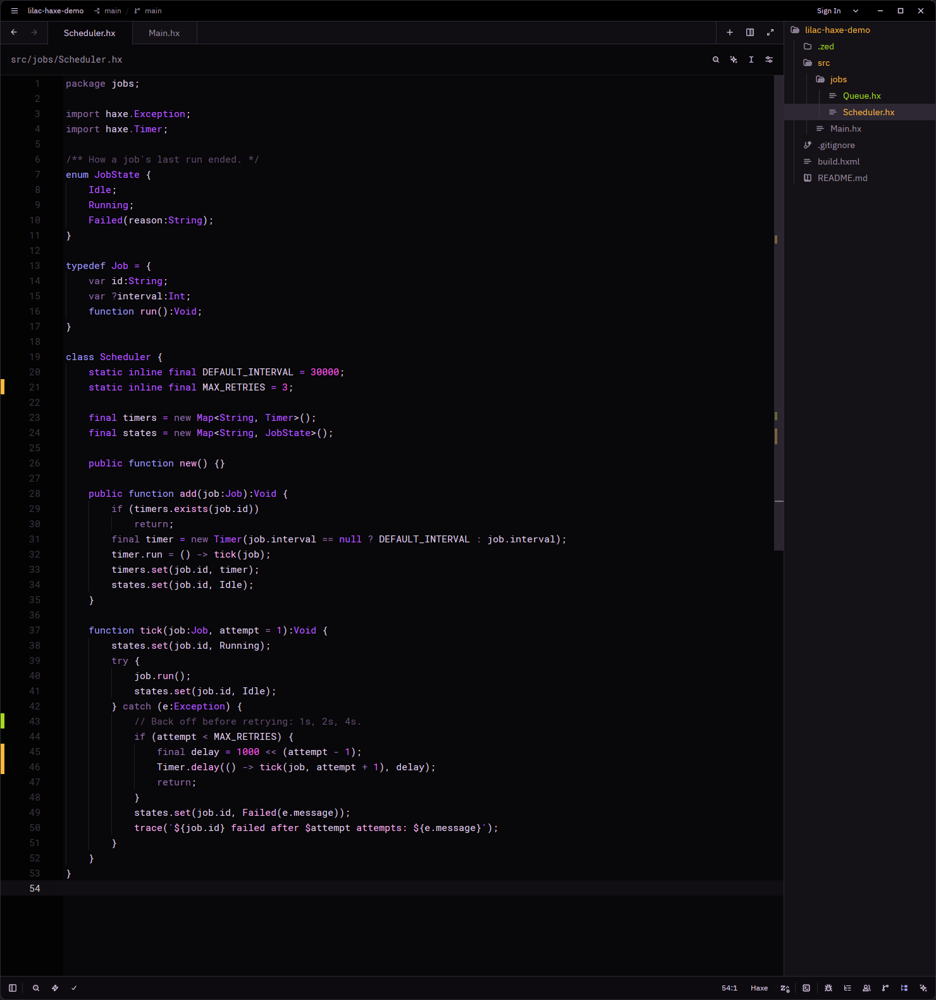

# Lilac for Zed

A Zed port of [Lilac](https://github.com/shubham-saudolla/Lilac-Theme) by Shubham Saudolla, a dark theme with pastel colours. Colours come from the VS Code version's `themes/Lilac-color-theme.json`.



## Install (development)

1. In Zed, run `zed: install dev extension` from the command palette.
2. Select this folder.
3. Pick **Lilac** in the theme selector (`theme selector: toggle`).

## Differences from the VS Code version

Zed's theme format has no equivalent for some of Lilac's VS Code colours:

- **Status bar.** Lilac's status bar is `#9d89e2` with black text. Zed draws status bar text and icons with the same colours as the rest of the UI, so a light status bar would be unreadable. The port uses the dark chrome colour `#0d0b0f` instead.
- **Tab borders.** Lilac marks the active tab and modified tabs with a `#9d89e2` border. Zed has no theme key for tab borders, so only the background tells the active tab (`#080709`) from inactive tabs (`#121014`).
- **No-folder status bar.** Zed has no separate status bar colour for a window with no folder open.
- **Underlined class names.** Zed's `font_style` supports italic but not underline.
- **Panels.** Zed uses one `panel.background` for side and bottom docks. The port uses the VS Code side bar colour, `#151217`. The terminal keeps its own `#000000` background.
- **Keyword colours.** VS Code gives declaration keywords (`const`, `let`, `function`, `def`, `class`) `#a29dfa` and control keywords `#8e6da6`. The port maps this to Zed's `keyword.declaration` and `keyword.definition` captures, which JavaScript, TypeScript and Python emit. The Haxe extension tags `function` as `keyword.function` and modifiers (`public`, `static`, `inline`) as `keyword.modifier`; the port colours these `#a29dfa` and `#b657ff` to match VS Code's `storage.type` and `storage.modifier`. Haxe's `var` stays `#8e6da6` because the grammar tags it as a plain keyword. Rust and other grammars don't tag declaration keywords separately, so all their keywords get `#8e6da6`.

## Recommended settings

A theme can't change layout or spacing. These settings in `~/.config/zed/settings.json` move panels closer to VS Code's layout. `unstable.ui_density` adds padding to tabs, buttons and the status bar; Zed marks it unstable, so it may be renamed or removed.

```json
{
  "unstable.ui_density": "comfortable",
  "project_panel": { "dock": "left" },
  "outline_panel": { "dock": "left" },
  "git_panel": { "dock": "left" },
  "debugger": { "dock": "left" },
  "terminal": { "dock": "bottom" },
  "agent": { "dock": "right" },
  "bottom_dock_layout": "contained"
}
```

## License

MIT, as with the original theme. See [LICENSE](LICENSE).
